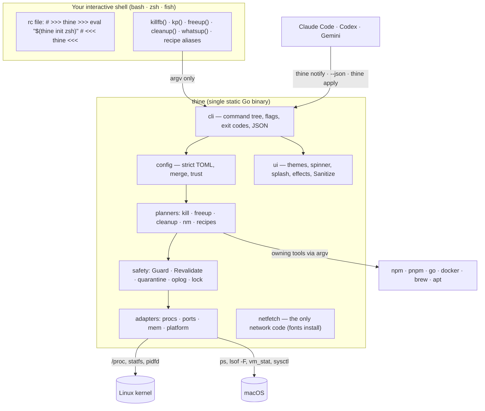

# Architecture

`thine` is one static Go binary. Your shell evaluates its output once at startup (`eval "$(thine init zsh)"`), which defines a handful of guarded one-line functions — `whoport`, `kp`, `killfb`, `freeup`, `cleanup`… — that call back into the binary. Everything interesting happens in the binary, where it can be typed, tested and kept safe.

## Packages

Everything lives under `internal/`; the public contract is the CLI, its exit codes and its `--json` output.

| Package | Responsibility |
|---|---|
| [`cmd/thine`](../cmd/thine/main.go) | Entry point; restores the cursor on Ctrl-C |
| [`internal/cli`](../internal/cli) | Command tree (cobra), global flags, output modes, exit-code mapping, every verb's UX |
| [`internal/ui`](../internal/ui) | Colour engine (truecolor → 256 → 16), nine themes, gradients, the star spinner, splash, confetti/rain/fireworks, boxes, gauges, prompts, `Sanitize` |
| [`internal/config`](../internal/config) | Defaults, strict TOML decoding, merge rules, validation, trust store, comment-preserving edits |
| [`internal/shellinit`](../internal/shellinit) | Init scripts for bash/zsh/fish, collision guard, `setup` rc-file edits, shadowed-definition finder |
| [`internal/procs`](../internal/procs) | Process snapshots, identity (PID + start time), pidfd signalling, tier classification, job scope |
| [`internal/ports`](../internal/ports) | Listening sockets: `/proc/net/tcp{,6}` + socket-inode mapping on Linux, `lsof -F` on macOS; Docker proxy detection |
| [`internal/mem`](../internal/mem) | Available memory, PSI / memory_pressure, swap, PSS-refined top consumers |
| [`internal/cleanup`](../internal/cleanup) | Category catalog, `Guard`, fingerprints, hardlink-aware sizing, artifact rules, apply engine |
| [`internal/quarantine`](../internal/quarantine) | Atomic same-filesystem moves, manifests, restore without overwriting, purge via `os.Root` |
| [`internal/oplog`](../internal/oplog) | Write-ahead JSONL operations log, ULID IDs, redaction, rotation |
| [`internal/recipes`](../internal/recipes) | Parameter binding, argv substitution, per-OS overrides, execution, rc-file import, starter pack |
| [`internal/fonts`](../internal/fonts) | Pinned Nerd Fonts catalog, detection, per-terminal setup hints |
| [`internal/netfetch`](../internal/netfetch) | SHA-256-verified downloads — the only package allowed to import `net/http` |
| [`internal/platform`](../internal/platform) | Paths, argv-only exec, sudo registry, locks, disk usage, OS/WSL/container/agent detection |

OS-specific code lives in `*_linux.go` and `*_darwin.go` files behind small functions (`ports.All`, `procs.Lookup`, `procs.Signal`, `mem.Read`, `platform.LoadAvg`); the domain logic above them never branches on the OS.

## A walk through `killfb`

1. Your shell runs `command thine kill --group fb`.
2. `cli` loads config — the `fb` group comes from a **trusted** project `.thinerc.toml`, else your global config, else the default `[3000, 3001]`.
3. `ports.All` reads `/proc/net/tcp{,6}` and maps socket inodes to PIDs; `procs.Lookup` fills in name, command line, cwd, owner and start time.
4. `procs.Policy.Classify` puts each process in a tier; for groups, `JobScope` adds the rest of the process group (the `pnpm dev` runner) when that's safe.
5. The plan prints. Dev-tier targets on named ports proceed; others need confirmation.
6. An `intent` record is appended to the ops log; each member gets SIGTERM through `pidfd`; a draining bar shows the grace period; survivors that are dev-tier get SIGKILL.
7. Ports are re-resolved: exit 0 only if every requested port is free — so `killfb && pnpm dev` is reliable.

## Output contract

- **stdout** carries results; **stderr** carries spinners, prompts, notes and animation — so `thine ports --json | jq` always works.
- `--json` emits a versioned document (`"schema_version": 1`) with no colour; errors become `{ "error": { "code", "message", "hint" }, "exit_code" }`.
- Exit codes are stable: see [the command reference](commands.md#exit-codes).

## Testing strategy

| Risk | Evidence |
|---|---|
| Parsers (`/proc/net/tcp`, `lsof -F`, `/proc/<pid>/stat`, `ps`, meminfo, PSI, vm_stat, swapusage) | Table tests from captured fixtures + fuzzing |
| Safety invariants S1–S12 | `TestS<n>_…` tests, traced by `scripts/trace-invariants.sh` |
| Path guard | Fuzzing over random trees full of symlinks |
| Kill flows | End-to-end: the test binary becomes a real TCP listener that ignores SIGTERM, in its own process group |
| Shell integration | Generated scripts sourced in real bash, zsh and fish, with pre-existing aliases |
| Quarantine | `apply ∘ undo = identity`, checked with content hashes and preserved symlinks |
| Startup latency | `thine bench` (cold start, init, sourcing delta) |

CI runs all of it on Linux (x64, arm64) and macOS (arm64, Intel), plus staticcheck, govulncheck and CodeQL.
